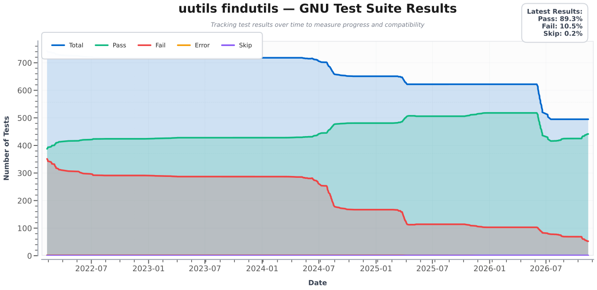
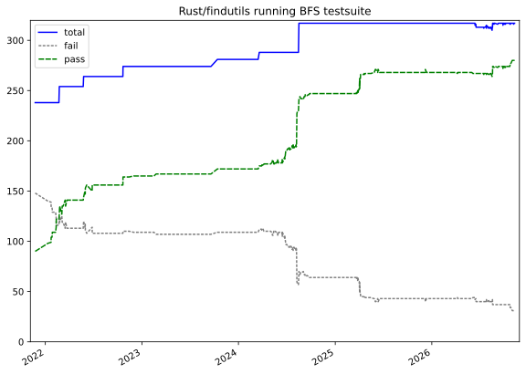

This project compares the evolution of [Rust/findutils](https://github.com/uutils/findutils) with the GNU & BFS testsuite for findutils.

The graphs are drawn by the code shared with the other uutils tracking repositories, see [uutils-tracking](https://github.com/uutils/uutils-tracking).
